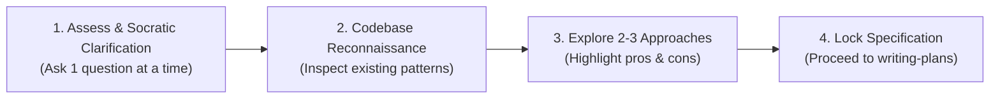

# Socratic Brainstorming & Requirement Refinement

Never jump immediately into implementation when requirements are vague, underspecified, or open to multiple conflicting architectural interpretations.

---

## 1. The 4-Phase Brainstorming Workflow

### Phase 1: Socratic Clarification
- When a user prompt has ambiguous scope or missing details, ask clarifying questions using `<ask_user>`.
- **Ask ONE question at a time** (preferably multiple-choice with clear tradeoffs).
- Do not bury the user in a wall of 10 simultaneous questions.
- If the user provides a preference, lock it into memory.

### Phase 2: Codebase Reconnaissance
- Inspect existing directory structures, dependencies, and configuration files.
- Anchor all design proposals to reality: check which libraries are already installed rather than inventing new external dependencies.

### Phase 3: Exploring Approaches
- Propose 2 to 3 distinct technical architectures (e.g., Approach A: Lightweight SQLite storage vs. Approach B: In-memory dictionary with disk snapshots).
- State trade-offs explicitly: complexity, performance, maintenance burden.
- State a recommended path with clear reasoning.

### Phase 4: Specification & Plan Handoff
- Summarize the agreed-upon direction.
- Immediately transition to `writing-plans` to author the implementation milestones.

---

## 2. Red Flags

- Generating code on a 5-word prompt without verifying what the user actually wants.
- Asking open-ended philosophical questions instead of concrete, actionable technical choices.
- Recommending architectures that require installing 5 unneeded packages when standard library alternatives suffice.
