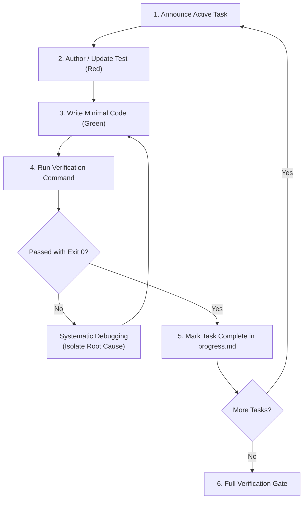

# Executing Implementation Plans

Once an implementation plan is created (via `writing-plans` or `<plan>`), execute it systematically. Do not skip steps, reorder tasks arbitrarily, or batch disparate changes into one uncontrolled edit.

---

## 1. Execution Loop

For each task in the plan:

1. **Announce Task:** Clearly state which task from the plan is now being executed.
2. **Follow TDD:** If functionality is changing, execute the failing test *before* implementing code.
3. **Minimal Code:** Write only enough code to pass the active milestone.
4. **Run Verification:** Execute the exact verification command listed in the plan.
5. **Record Progress:** Mark the task complete in `progress.md` or `task_plan.md` with supporting evidence.
6. **Move Sequentially:** Never jump ahead to Task N+2 while Task N is failing.

---

## 2. Handling Discrepancies & Unexpected Errors

If an implementation step produces unexpected test failures or errors:
- **Do NOT guess or try random patches.**
- Load the `systematic-debugging` framework:
  1. Capture exact stdout/stderr.
  2. Formulate a specific hypothesis explaining the divergence.
  3. Inspect logs or minimal reproductions before changing more code.

---

## 3. Completion Contract

Before moving from Task N to Task N+1:
- Verification command must return exit code `0`.
- All newly introduced files must pass syntax compilation (`python -m py_compile`).
- Any newly created tests must pass reliably.
