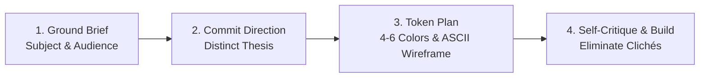

# `frontend-design` — Senior Design Direction & Anti-Slop Guidelines

Authored by Anthropic and cataloged on AgenticSkills.io, this skill prevents coding agents from producing generic, repetitive "AI slop" interfaces (predictable purple gradients, identical centered SaaS cards, generic hero eyebrow tags, and ubiquitous arrow buttons).

## The 4-Phase Design Workflow

### Phase 1: Clarify and Ground the Brief
- If a user prompt is brief (e.g. "make a dashboard"), anchor the design to a concrete domain, audience, and job-to-be-done before coding.
- Ask: What specific data is being viewed? Who is making decisions from this screen? What is the single primary action?

### Phase 2: Commit to a Visual Direction (Reject Cookie-Cutter Defaults)
Deliberately select a distinct visual thesis matching the subject:
- **High-Density Technical** (Monospace numbers, subtle borders, compact spacing, keyboard shortcuts).
- **Refined Editorial** (Warm stone backgrounds, elegant serif display, high typographic contrast).
- **Tactile Modernist** (Layered ambient shadows, concentric radii, spring physics, active press depth).
- **Industrial / Utilitarian** (Raw functional borders, high contrast data tables, stark typography).
- **Anti-Pattern Ban**: Forbid default "purple gradient over black" or "white card with terracotta accent" unless explicitly requested.

### Phase 3: Token Architecture & Wireframing
Draft a compact token plan before authoring markup:
1. **Palette (4–6 Named Colors)**:
   - Surface Canvas (e.g., `#0d1117` or `#fafafa`)
   - Surface Elevated (e.g., `#161b22` or `#ffffff`)
   - Border Subtle (e.g., `rgba(255,255,255,0.08)`)
   - Primary Accent (single deliberate brand color)
   - Text Dominant & Text Muted
2. **Typography Scale**:
   - Explicit font roles (Sans, Mono, Display).
   - Constrained sizes (Display, H1, H2, Body, Caption, Code).
3. **ASCII Wireframe**: Map the layout hierarchy before writing CSS/Tailwind.

### Phase 4: Self-Critique Against AI Clichés
Before emitting code, audit against the cliché checklist:
- [ ] Did I add unnecessary `→` arrows to every button? (Remove unless directional navigation).
- [ ] Are all cards identical rounded rectangles? (Vary layout density and visual hierarchy).
- [ ] Did I use arbitrary fixed heights (`h-64`) on text containers? (Replace with fluid flex/grid).
- [ ] Is keyboard focus clearly visible (`:focus-visible`)?
- [ ] Are numbers set to tabular figures (`tabular-nums`)?
- [ ] Does the design look custom-crafted rather than AI-generated?
