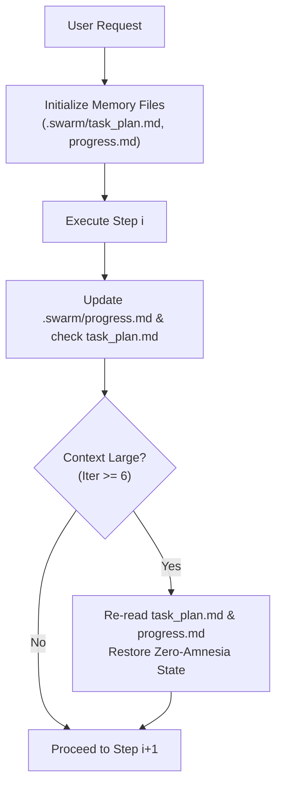

# Planning With Files (Persistent Working Memory)

Context windows are volatile, lossy, and prone to degradation as conversation history grows.
When executing multi-step tasks, you MUST anchor your working state to **persistent disk files** rather than relying on chat context memory.

---

## 1. The Three Memory Files

Whenever starting a non-trivial or multi-step engineering task, create or maintain these files in `workspace/.swarm/` (or `workspace/`):

1. **`task_plan.md` (The Strategic Roadmap):**
   - High-level objective and acceptance criteria.
   - Ordered checklist of phases and sub-tasks with checkboxes (`- [ ]`, `- [x]`).
   - Links to target files to modify.

2. **`findings.md` (Accumulated Discoveries):**
   - Crucial architectural constraints, existing patterns, and codebase conventions discovered during exploration.
   - Known quirks, library versions, and environmental limitations.

3. **`progress.md` (Real-Time State Ledger):**
   - Currently active subtask.
   - Exact commands run and outcomes.
   - Unresolved blockers or discrepancies.

---

## 2. Compaction Survival Workflow

When the system triggers context auto-compaction (or when recovering from session resets):
1. **Never attempt to guess or recall previous actions from memory.**
2. Immediately read `workspace/.swarm/task_plan.md` and `workspace/.swarm/progress.md` using `<execute_bash>`.
3. Pick up execution at the first unchecked box (`- [ ]`) in `task_plan.md`.

---

## 3. Strict Rules

- **Disk Over Context:** Every completed subtask MUST be checked off in `task_plan.md` via `<replace_block>` or `<write_file>`.
- **Atomic Progress:** Record error messages, root causes, and verification proof in `progress.md` immediately after execution.
- **Zero Loss:** A session can be safely wiped at any iteration and resumed seamlessly because all state resides on disk.
