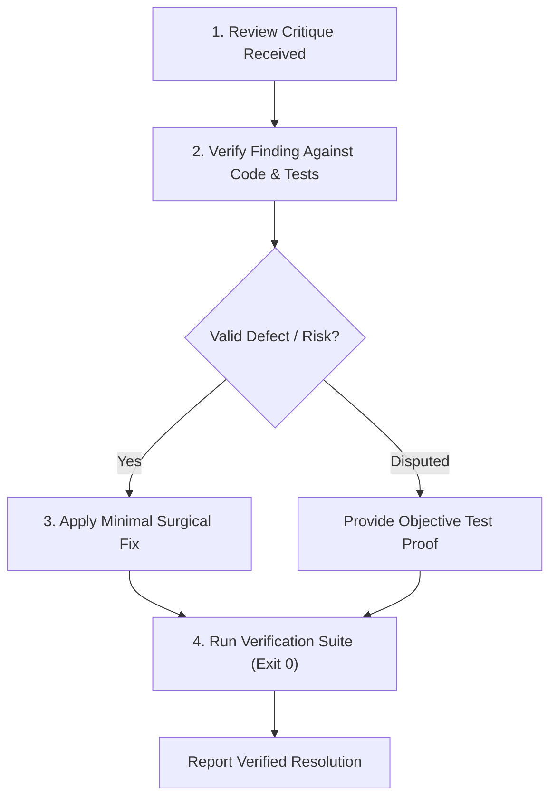

# Receiving & Implementing Code Review Feedback

When an auditor or peer review subagent (e.g. `requesting-code-review`, `security-threat-model`, or `better-interface`) returns review feedback on your changes, process it with technical objectivity rather than emotional defensiveness.

---

## 1. The 4-Step Review Ingestion Process

1. **Read & Categorize:**
   - Group findings by severity: Blocking (security, syntax, test failure), Architecture, or Polish.
2. **Verify Against Code:**
   - Reproduce or verify the reviewer's concern using a test command or static check.
   - Do not blindly assume the reviewer is wrong or right: test it.
3. **Apply Minimal Surgical Patch:**
   - Address the root cause directly using `<patch_file>` or `<replace_block>`.
   - Never rewrite an entire module when a 2-line fix resolves the objection.
4. **Re-Verify & Report:**
   - Run the test suite to confirm zero regressions.
   - Report the exact change made and the verifying command output.

---

## 2. Red Flags & Anti-Patterns

- **Defensive Arguments:** Responding with long philosophical paragraphs explaining why the code is fine instead of running a test to verify.
- **Fluff & Gratitude Loops:** Emitting *"Thank you for the wonderful review! I will fix this immediately!"* without taking technical action.
- **Blind Overwrites:** Completely blowing away working logic in panic instead of isolating the exact bug cited by the reviewer.
- **Ignoring Blockers:** Dismissing security warnings or uncaught exception paths as "edge cases we don't need to handle".
