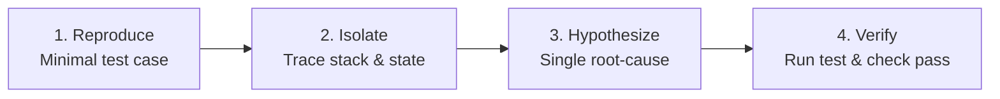

# `systematic-debugging` — Root-Cause Isolation Protocol

This skill prevents speculative, trial-and-error edits ("shotgun debugging") by enforcing a structured 4-step investigation pipeline whenever tests fail or bugs are reported.

## The 4-Step Protocol

### Step 1: Reproduce with a Minimal Test Case
- Never edit production files until the failure can be reproduced deterministically with a command or test script.
- If no automated test exists, author a minimal reproduction script (`test_repro.py` or `repro.test.ts`) that exhibits the exact failure mode (exit code $\ne 0$).

### Step 2: Trace and Isolate the Failure Point
- Inspect the exact call stack, execution line, and runtime variables at the moment of failure.
- Avoid guessing what happened; print or log the intermediate state preceding the crash.
- Differentiate between the **trigger** (input data) and the **root flaw** (broken assumption, missing check, unhandled null).

### Step 3: Formulate a Single-Variable Hypothesis
- Articulate the specific underlying bug in one clear sentence:
  *"Function `X` fails when input `Y` is passed because condition `Z` assumes non-null."*
- Propose the minimal surgical change that addresses the root cause directly without restructuring unrelated subsystems.

### Step 4: Verify and Check for Regressions
- Apply the patch.
- Run the reproduction script to confirm it now passes (exit code $0$).
- Run the entire test suite to guarantee zero regressions.
- Remove temporary debugging logs or reproduction files.
