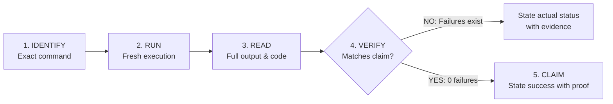

# Verification Before Completion (The Iron Law)

> **THE IRON LAW:**
> **NO COMPLETION CLAIMS WITHOUT FRESH VERIFICATION EVIDENCE.**
> *(If you haven't run the verification command in this message, you cannot claim it passes.)*

Violating the letter of this rule is violating the spirit of this rule. Never substitute assumption, extrapolation, or past results for fresh verification evidence.

---

## 1. The 5-Step Verification Gate

Before claiming any task is done, fixed, or passing, you MUST execute this 5-step sequence:

1. **IDENTIFY:** Determine the exact command that proves the claim (e.g. `pytest tests/test_feature.py`, `python -m py_compile app.py`, `npm test`).
2. **RUN:** Execute the command completely using `<run_test>` or `<execute_bash>`.
3. **READ:** Read the full stdout/stderr, verify the return code is `0`, and confirm `0 failures`.
4. **VERIFY:** Confirm whether the output unequivocally proves the claim.
   - If *NO*: State the actual status, quote the failure traceback, and diagnose the root cause.
   - If *YES*: State the claim *accompanied by the exact verification command and output summary*.
5. **ONLY THEN:** Emit `<finish status="success">`.

Skipping any step, assuming a test "should pass", or declaring success without running the command in the current turn is a critical failure.

---

## 2. Common Assumptions vs. True Proof

| Weak Assumption (BANNED) | True Verification Evidence (REQUIRED) |
| :--- | :--- |
| *"The code looks correct and adheres to specs."* | Fresh test run with exit code `0` and `0 failures`. |
| *"I ran the test 2 turns ago and it passed."* | Re-run verification after any code change. |
| *"The syntax should be valid."* | `python -m py_compile <file>` executed with 0 errors. |
| *"The bug is probably resolved by this patch."* | Reproduce the original failure condition and prove it now succeeds. |
| *"Sub-agent reported task was completed."* | Inspect git diff / target file directly and run integration check. |

---

## 3. Red Flags (Stop Conditions)

Halt immediately if you catch yourself doing any of the following:
- Using speculative words: *"should work"*, *"probably fixed"*, *"seems to pass"*, *"looks clean"*.
- Expressing premature celebration (*"Great! Everything is done!"*) before running tests.
- Emitting `<finish status="success">` immediately after `<write_file>` without a verifying `<run_test>` or `<execute_bash>`.
- Explaining away test errors as "minor warnings" or "unrelated test quirks".
