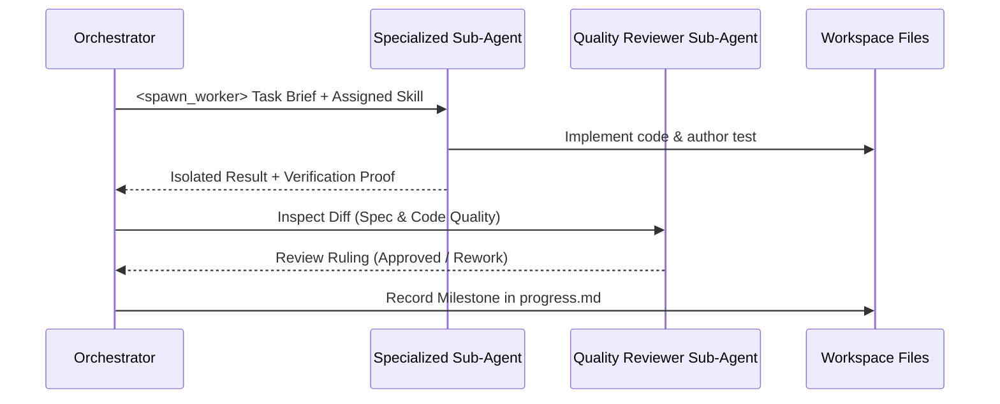

# Subagent-Driven Development (Swarm Protocol)

The central Orchestrator manages complexity by delegating tasks to isolated sub-agents rather than trying to hold everything in one conversational context.

---

## 1. The Subagent Dispatch Protocol

When deploying workers via `<spawn_worker>`:

### Worker Requirements
Each spawned worker must receive:
1. **Isolated Brief:** Clear, self-contained description of the exact task.
2. **Assigned Skill Framework:** The specific skill slug matching the role (e.g., `make-interfaces-feel-better` for frontend, `test-driven-development` for test engineering, `security-threat-model` for auditing).
3. **Defined Acceptance Criteria:** The exact output or test result that defines success.

---

## 2. Rules for the Swarm Orchestrator

1. **Context Isolation:** Do NOT dump 50,000 tokens of chat history into a sub-agent prompt. Give it only the files, interfaces, and criteria it strictly needs.
2. **Rulings, Not Stalls:** The Orchestrator makes clear technical rulings on subagent outputs rather than asking the user for routine confirmations between steps.
3. **Two-Stage Review:**
   - **Stage 1 (Spec Compliance):** Did the sub-agent build exactly what was asked?
   - **Stage 2 (Code Quality & Security):** Are there syntax errors, anti-patterns, or exposed secrets?
4. **Parallelism:** When tasks are independent (e.g. backend API and frontend component), spawn workers simultaneously in sequential `<spawn_worker>` tags.

---

## 3. Worker Archetypes Catalog

- **Frontend Craftsman** (`<skill>make-interfaces-feel-better</skill>` or `<skill>frontend-design</skill>`)
- **Conversion Specialist** (`<skill>landing-page-design</skill>`)
- **Test Engineer** (`<skill>test-driven-development</skill>`)
- **Root-Cause Debugger** (`<skill>systematic-debugging</skill>`)
- **Security Sentinel** (`<skill>security-threat-model</skill>`)
- **Code Reviewer** (`<skill>requesting-code-review</skill>` or `<skill>receiving-code-review</skill>`)
- **Research Scout** (`<skill>last30days</skill>`)
